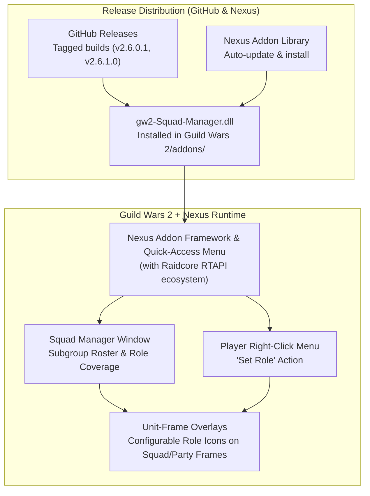

<p align="center">
  <a href="https://ko-fi.com/todd0042">
    
  </a>
</p>

---

# 🛡️ GW2 Squad Manager

[](https://github.com/Todd0042/gw2-Squad-Manager-release/releases)
[]()
[-1f6feb.svg)](https://raidcore.gg/nexus)
[](LICENSE)
[](https://ko-fi.com/todd0042)

> **Organize your Guild Wars 2 squad and party by role in real time — with subgroup roster tracking, primary and secondary role assignments, right-click "Set Role" menus, and live unit-frame overlays inside Nexus.**

---

## 📖 Table of Contents

* **Part 1 — User Overview & Quick Start**
  * [🛡️ What Is GW2 Squad Manager?](#-what-is-gw2-squad-manager)
  * [⚡ How It Works in 3 Steps](#-how-it-works-in-3-steps)
  * [✨ Key Features at a Glance](#-key-features-at-a-glance)
  * [🚀 Quick Start & Installation](#-quick-start--installation)
* **Part 2 — Technical Architecture & Reference**
  * [1. Distribution & Addon Architecture ([README.md](README.md))](#1-distribution--addon-architecture)
  * [2. In-Game Workflow, Role Model & Controls](#2-in-game-workflow-role-model--controls)
  * [3. Customization, Frame Overlays & Auto-Updates](#3-customization-frame-overlays--auto-updates)
  * [4. Repository Structure ([LICENSE](LICENSE), [README.md](README.md))](#4-repository-structure)
  * [5. Verification, Releases & Integrity](#5-verification-releases--integrity)
  * [6. Acknowledgments, License & Support ([LICENSE](LICENSE))](#6-acknowledgments-license--support)

---

# Part 1 — User Overview & Quick Start

## 🛡️ What Is GW2 Squad Manager?

**GW2 Squad Manager** is a [Nexus](https://raidcore.gg/nexus) addon (`gw2-Squad-Manager.dll`) for **Guild Wars 2** built to help commanders, raid leaders, and party members organize squads and parties by role without leaving the game.

Instead of tracking roles in chat or external spreadsheets, GW2 Squad Manager brings role management directly into your UI:
1. **📋 Subgroup Roster View**: Inspect everyone currently in your squad or party, organized cleanly by subgroup.
2. **🎯 Primary & Secondary Role Assignment**: Assign built-in or custom roles (such as healer, DPS, tank, kiter, positions, and more) from the Squad Manager window or straight from a player's right-click menu.
3. **🖼️ Live Unit-Frame Overlays & Role Coverage**: Display role icons directly on the in-game squad and party frames while checking overall squad role coverage at a glance.

---

## ⚡ How It Works in 3 Steps

1. **Install via Nexus or Manual DLL**: Install **GW2 Squad Manager** directly from the Nexus addon library, or drop `gw2-Squad-Manager.dll` into your `Guild Wars 2/addons/` directory.
2. **Open & Assign Roles**: Launch Guild Wars 2, open **GW2 Squad Manager** from the Nexus quick-access menu, and assign roles in the window—or right-click any squad member and choose **Set Role**.
3. **Read Roles at a Glance**: Assigned role icons appear automatically on your in-game squad and party unit frames, and the role coverage view updates to show which roles your group has covered.

---

## ✨ Key Features at a Glance

* **👥 Subgroup Roster Tracking**: View every member of your squad or party grouped by subgroup.
* **🎭 Primary & Optional Secondary Roles**: Assign each player a primary role plus an optional secondary role, including healer, DPS, tank, kiter, positions, and more.
* **🖱️ Right-Click "Set Role" Integration**: Assign or update a player's role directly from their in-game right-click context menu.
* **🖼️ Unit-Frame Role Overlays**: Automatically renders each member's role icon on the in-game squad and party frames so commanders and teammates can read compositions instantly.
* **📊 Squad Role Coverage Overview**: Get a quick summary of which roles are currently covered across your squad.
* **🎨 Customizable Layouts & Custom Roles**: Adjust where role icons sit on unit frames and define your own custom roles to match your group's terminology or encounter mechanics.
* **🔄 Nexus Auto-Updating**: Receives updates automatically when installed and managed through Nexus.

---

## 🚀 Quick Start & Installation

### Option 1: Install via Nexus Addon Library (Recommended)
1. Install **[Nexus](https://raidcore.gg/nexus)** for Guild Wars 2.
2. Open the Nexus addon library inside Guild Wars 2 and install **GW2 Squad Manager**.
3. Nexus handles installation and future automatic updates for you.

### Option 2: Manual DLL Installation
1. Ensure **[Nexus](https://raidcore.gg/nexus)** is installed for your Guild Wars 2 client.
2. Download `gw2-Squad-Manager.dll` from the [GitHub Releases](https://github.com/Todd0042/gw2-Squad-Manager-release/releases) page.
3. Place `gw2-Squad-Manager.dll` in your Guild Wars 2 addons directory:
   ```text
   Guild Wars 2/addons/gw2-Squad-Manager.dll
   ```
4. Launch **Guild Wars 2** and open **GW2 Squad Manager** from the Nexus quick-access menu.

---
---

# Part 2 — Technical Architecture & Reference

> *Note: `gw2-Squad-Manager-release` is the **release distribution repository** for GW2 Squad Manager. It hosts the distribution documentation ([README.md](README.md)), license ([LICENSE](LICENSE)), and tagged binary releases (`gw2-Squad-Manager.dll` on [GitHub Releases](https://github.com/Todd0042/gw2-Squad-Manager-release/releases)). Source files and build scripts are not stored in this repository.*

---

## 1. Distribution & Addon Architecture

GW2 Squad Manager ships as a standalone Windows dynamic-link library (`gw2-Squad-Manager.dll`) loaded by the **Nexus** addon framework alongside Raidcore's **RealTime API (RTAPI)** ecosystem.



### Runtime Integration Points
* **Addon Host (`Guild Wars 2/addons/gw2-Squad-Manager.dll`)**: Loaded by Nexus at game launch and accessible from the Nexus quick-access menu.
* **Framework & API Ecosystem**: Built for **Nexus** and alongside the MIT-licensed **RealTime API (RTAPI)** by Raidcore.
* **Release Channel**: Distributed via tagged releases (`v2.6.0.1`, `v2.6.1.0`) on [GitHub Releases](https://github.com/Todd0042/gw2-Squad-Manager-release/releases) and indexed for automatic updates through Nexus.

---

## 2. In-Game Workflow, Role Model & Controls

Once loaded in Guild Wars 2, all squad management interactions operate in-game without external overlays or browser windows:

| Component / Control | Behavior & Capabilities |
| :--- | :--- |
| **Nexus Quick-Access Menu** | Opens and toggles the main **Squad Manager** window inside Guild Wars 2. |
| **Roster Tracker** | Lists all active squad or party members, grouped by their current subgroup. |
| **Role Assignment (Window)** | Assigns a **primary role** and an optional **secondary role** to any member (e.g., healer, DPS, tank, kiter, positions, and custom roles). |
| **Right-Click `"Set Role"`** | Adds a `"Set Role"` entry to a player's right-click menu so leaders can tag players directly without switching focus to the roster table. |
| **Role Coverage View** | Summarizes which roles are represented across the squad so missing boons, healers, or mechanics roles are immediately visible. |
| **Unit-Frame Overlays** | Automatically draws assigned role icons directly onto the in-game squad and party unit frames. |

---

## 3. Customization, Frame Overlays & Auto-Updates

* **Unit-Frame Icon Placement**: Role icon positioning on the in-game squad and party unit frames is customizable so icons fit cleanly alongside your existing UI layout without obscuring health bars or player names.
* **Custom Role Definitions**: Beyond the built-in roles (healer, DPS, tank, kiter, positions, and more), you can define custom roles tailored to specific raids, strikes, WvW compositions, or encounter-specific mechanics.
* **Nexus Auto-Updating**: When installed through Nexus, new tagged releases of `gw2-Squad-Manager.dll` are pulled automatically by Nexus's addon updater.

---

## 4. Repository Structure

This repository contains the release distribution metadata, documentation, and license for GW2 Squad Manager:

```text
gw2-Squad-Manager-release/
├── LICENSE                      # PolyForm Noncommercial License 1.0.0 (Copyright (c) 2026 Todd0042)
└── README.md                    # User guide, installation instructions & release reference
```

| Item | Description |
| :--- | :--- |
| [README.md](README.md) | User overview, Nexus & manual DLL installation guide, usage workflow, and release reference. |
| [LICENSE](LICENSE) | Full text of the **PolyForm Noncommercial License 1.0.0** governing distribution and use. |
| [GitHub Releases](https://github.com/Todd0042/gw2-Squad-Manager-release/releases) | Hosts compiled `gw2-Squad-Manager.dll` release binaries (tagged `v2.6.0.1`, `v2.6.1.0`). |

---

## 5. Verification, Releases & Integrity

Because `gw2-Squad-Manager-release` is a binary distribution repository (with no source code or test harness committed in the repository tree), verification is performed against the release artifact and in-game Nexus integration:

1. **Verify File Placement (Manual Install)**:
   Confirm `gw2-Squad-Manager.dll` downloaded from [GitHub Releases](https://github.com/Todd0042/gw2-Squad-Manager-release/releases) resides directly inside `Guild Wars 2/addons/`.
2. **Verify Nexus Addon Load**:
   Launch Guild Wars 2 and confirm **GW2 Squad Manager** appears in the Nexus quick-access menu and opens its window cleanly.
3. **Verify In-Game Role Flow**:
   - Join a party or squad and confirm members appear grouped by subgroup.
   - Right-click a member and verify **Set Role** assigns primary/secondary roles.
   - Confirm role icons render on the squad/party unit frames and update the role coverage view.

---

## 6. Acknowledgments, License & Support

### Acknowledgments
* **SquadRoles** by xvwyh — inspiration for in-game squad role tracking and assignment.
* **Nexus** and the **RealTime API (RTAPI)** by Raidcore — the addon framework and prior work this builds alongside (RTAPI is MIT-licensed).

> *This is an independent project and is not affiliated with or endorsed by the above, or by ArenaNet.*

### License
* Licensed under the [PolyForm Noncommercial License 1.0.0](LICENSE) — free for personal, hobby, educational, research and nonprofit use; commercial use (inside a company, in a paid product or service, or for profit) requires a separate license from [Todd0042](https://github.com/Todd0042).

### Bug Reports & Support
* Found a bug or have a feature request? Open an issue on the [GitHub Issues](https://github.com/Todd0042/gw2-Squad-Manager-release/issues) page.

---

<p align="center">
  If GW2 Squad Manager helps keep your squad organized, consider supporting development:<br/><br/>
  <a href="https://ko-fi.com/todd0042" target="_blank">
    
  </a>
</p>

---

<p align="center">
  <a href="https://ko-fi.com/todd0042">
    
  </a>
</p>
